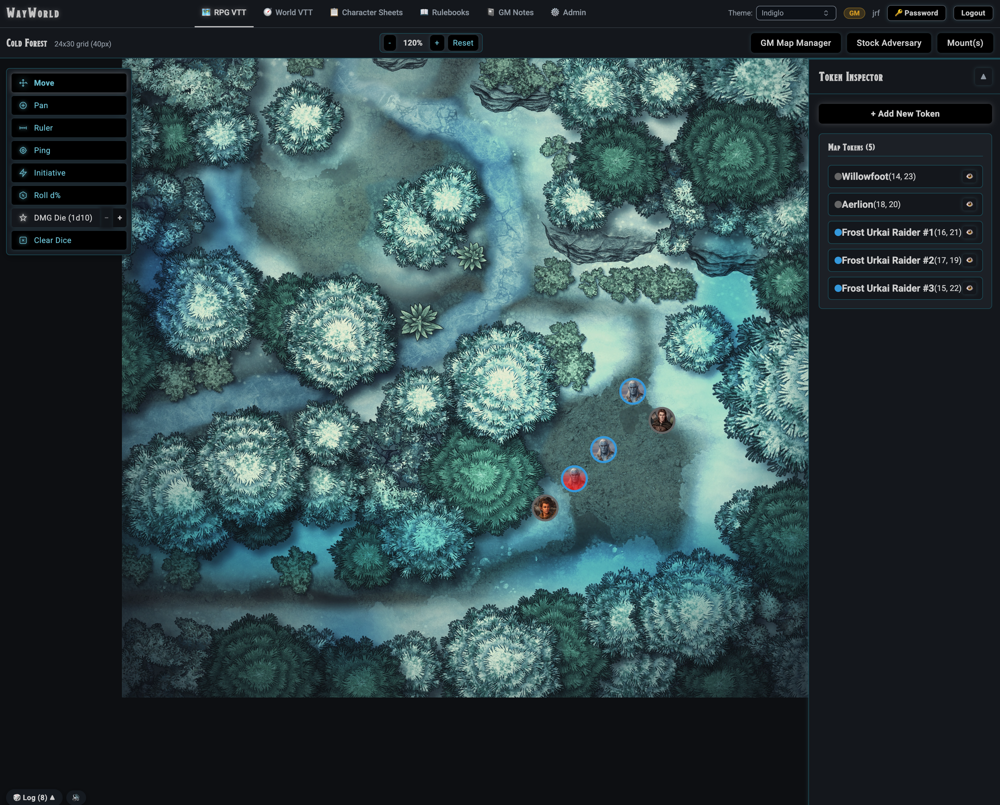
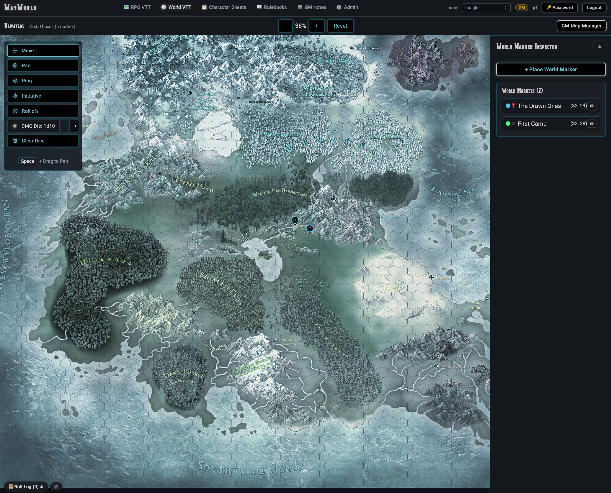
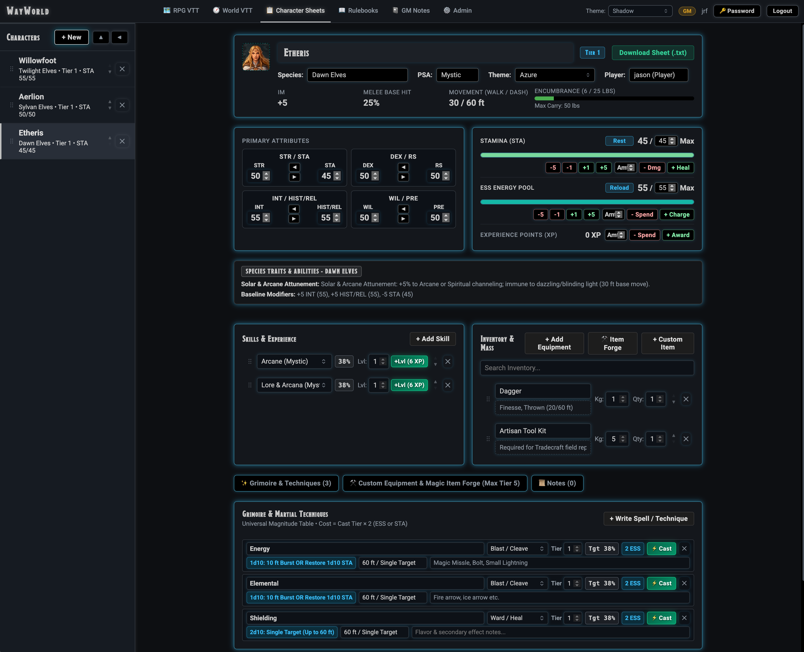
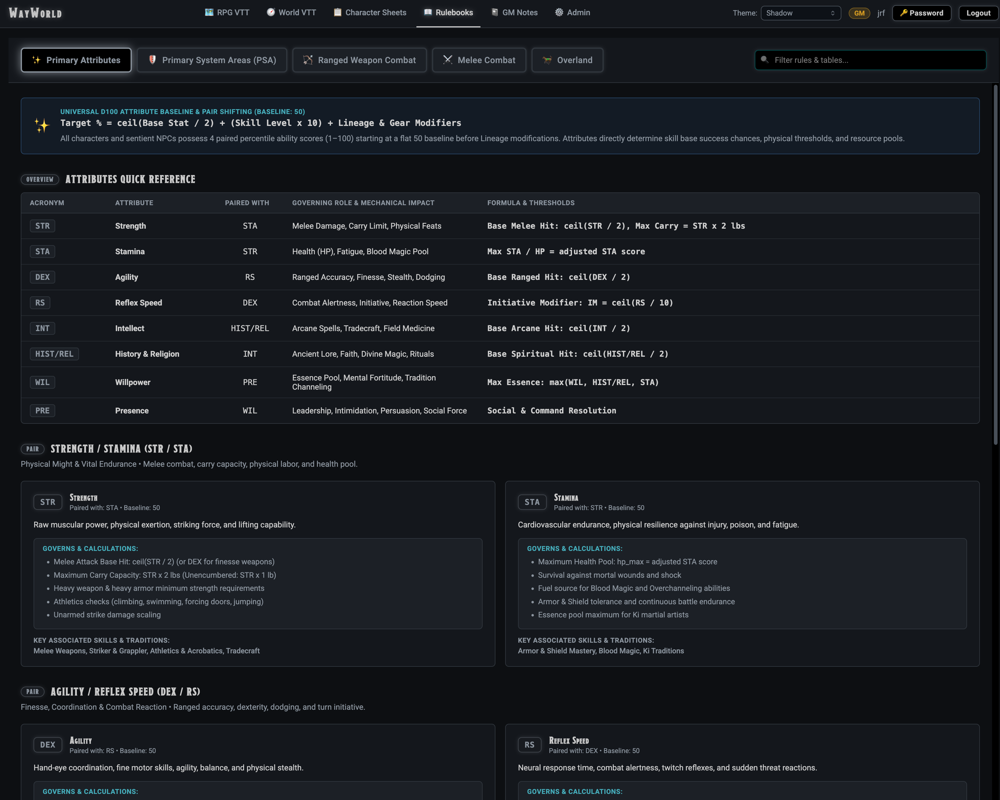

# ⚔️ Wayworlds VTT

A full-stack, real-time multiplayer Virtual Tabletop (VTT), overland campaign atlas, and digital character management platform built for the **Wayworlds d100** heroic fantasy roleplaying system.

---

## 📸 Screenshots & UI Tour

<p align="center">
  
  <em>Tactical RPG VTT Canvas: Square battle grid with custom tokens, distance ruler, dice rollers, and collapsible inspector.</em>
</p>

<p align="center">
  
  <em>World VTT (Overland & Regional Atlas): Hex map with interactive markers, distance calculations, and linked tactical scenes.</em>
</p>

<p align="center">
  
  <em>Interactive Character Sheet: Wayworlds d100 stats, stamina/essence gauges, grimoire & martial techniques, and equipment forge.</em>
</p>

<p align="center">
  
  <em>Rulebooks & Compendium: Searchable reference documentation and rules lookup integrated directly into the tabletop.</em>
</p>

---

## ✨ Features

### 🗺️ Dual Tactical & World VTT Engines
* **Tactical RPG VTT Grid:** Square tactical battle canvas with customizable grid size, line thickness, and visibility. Supports multi-cell token footprints (1×1, 2×2, 3×3), distance ruler, real-time map pings, token snapping, and GM visibility layers.
* **WorldVTT (Overland & Regional Atlas):** Hex-grid regional map supporting interactive `WorldMarker` pins (`party`, `battle`, `faction`, `poi`, `hazard`), overland coordinates in miles and hexes (`q/r`), and one-click scene transitions linking world markers directly to Tactical VTT battle maps.

### 🎲 3D Physics Dice Roller & Audio
* **Realistic 3D Dice:** WebGL-accelerated 3D dice powered by Babylon.js and Ammo.js physics running directly in the browser.
* **Specialized Roll Types:** Preconfigured for percentile skill checks (`d100` with tens/ones color distinction), combat initiative, and Universal Magnitude Table damage/effect dice (`1d10` through `20d10`).
* **Shared Die Roll Log:** Real-time 20-roll history broadcast across all connected players via Socket.io with roller attribution.
* **Synchronized Audio:** Tabletop dice-rolling sound effects with per-user volume validation and mute controls.
* **Instant Dismissal:** Dismiss 3D dice and banner results with `✖ Clear Dice` or the `Escape` key.

### 📋 Interactive Digital Character Sheets
* **Wayworlds d100 Character Sheets:** Complete ability score management (`STR/STA`, `DEX/RS`, `INT/LOG`, `PER/LDR`), Stamina (`STA`) and Essence (`ESS`) energy pool trackers, prominent overall **Character Tier (`Tier 1–5`)** badges, species abilities, and skill progression.
* **Grimoire & Martial Techniques:** Author and cast custom named spells and martial techniques tied to Magic and Ki traditions (`Arcane`, `Divine`, `Primal`, `Occult`, `Runic`, `Martial Ki`) and the **Universal Magnitude Table**, automatically consuming `Cast Tier × 2` in `ESS` or `STA` and rolling `Nd10` magnitude effects.
* **Custom Equipment & Magic Item Forge:** In-sheet crafting applet capped by the character's `Lvl 1–6` Tradecraft rank (`Tier 1` Mundane through `Tier 5` Runeforged/Magic), enforcing clean `Nd10` damage dice and percentile hit/parry modifiers without flat `+` damage numbers.

### 👾 Automated Adversary & Creature Stocking
* **Procedural Threat Tier Scaling:** Instantly stock sentient NPCs or monstrous creatures with procedural Threat Tier scaling (`Tiers 1–5`).
* **AI Token Art Generation:** Built-in generative AI token pipeline featuring circular token masking and color-coded threat tier border rings.
* **Adversary Token HUD:** Live combat action buttons, weapon attacks, damage rolls, and wound/stamina delta tracking directly on the tactical canvas.

### 🛞 Tactical Mounts, Wagons & Conveyances
* **Canonical Fantasy Conveyances:** Warhorses, Draft Wagons, Armored War Wagons, Wyvern Riders, Arcane Skiffs, Dwarven Steam-Crawlers, and more.
* **Custom Vehicle & Mount Builder:** Design and persist custom conveyances to the database.
* **Tactical Conveyance HUD:** Live speed controls (`+ Accel`, `- Decel`, `Emergency Stop`), Essence (`ESS`) energy/stamina gauge, and damage condition toggles.

### 🎨 Dark UI & Dynamic Color Packages
* **Permanent Dark Backdrop:** Enforced `#0d0f12` main canvas and `#14171c` elevated panels with Modesto display typography for headers, banners, and tier badges.
* **Live Theme Switcher (`data-color-pkg`):** Instant switching between **Maroons**, **Greens**, **Blues**, **Blues & Greens**, and **Oranges & Maroon** to customize panel borders, scrollbars, checkboxes, and widget accents.

### 🗂️ GM Tools, Notes & Asset Manager
* **GM Session Notes:** Private GameMaster session notebooks with reorderable readout and encounter panels.
* **Full Asset Lifecycle:** Upload, organize, rename, and move images into custom subdirectories with atomic cascades across tokens, maps, and character sheets.

---

## 🛠️ Tech Stack

* **Frontend:** [Vue 3](https://vuejs.org/) (Composition API / `<script setup>`), [Vite](https://vitejs.dev/), [Pinia](https://pinia.vuejs.org/), [Vue Router](https://router.vuejs.org/), [Babylon.js](https://www.babylonjs.com/) & [Ammo.js](https://github.com/kripken/ammo.js/) (3D physics dice), [Lunr.js](https://lunrjs.com/).
* **Backend:** [Node.js](https://nodejs.org/), [Express](https://expressjs.com/), [Socket.io](https://socket.io/) (real-time WebSocket synchronization), [Better-SQLite3](https://github.com/WiseLibs/better-sqlite3), [Sharp](https://sharp.pixelplumbing.com/) (image processing).
* **Testing & Quality:** [Vitest](https://vitest.dev/) (unit & component tests across client and server), [Supertest](https://github.com/ladjs/supertest).
* **Deployment:** [Docker](https://www.docker.com/) & Docker Compose (`ww-vtt-ctl.sh`).

---

## 🚀 Quick Start

### Option 1: Control Script & Docker (Recommended)

1. **Clone the repository:**
   ```bash
   git clone git@github.com:jayrfink/wayworlds-vtt.git
   cd wayworlds-vtt
   ```

2. **Start the container and servers:**
   ```bash
   ./ww-vtt-ctl.sh start
   ```

3. **Open the application:**
   * **Client (VTT):** [http://localhost:3001](http://localhost:3001)
   * **Server API:** [http://localhost:3000](http://localhost:3000)

4. **Initial Setup:**
   * The first user registered through the UI automatically receives the **GameMaster** role. Subsequent registrations default to **Player** unless assigned by the GM.

---

### Option 2: Local Development

1. **Prerequisites:** Node.js (v20+) and npm.

2. **Install dependencies:**
   ```bash
   # Root & shared dependencies
   npm install

   # Client dependencies
   cd client && npm install && cd ..

   # Server dependencies
   cd server && npm install && cd ..
   ```

3. **Run the development servers:**
   ```bash
   # Terminal 1: Backend Server (Port 3000)
   cd server && npm run dev

   # Terminal 2: Frontend Client (Port 3001)
   cd client && npm run dev -- --host
   ```

---

## 🧪 Running Tests

The test suite covers both frontend components and backend REST/Socket APIs:

```bash
# Run server test suite (278 tests across 21 suites)
cd server && npm test -- --run

# Run client test suite (549 tests across 46 suites)
cd client && npm test -- --run
```

---

## 📜 License

* **Codebase:** Distributed under the MIT License.
